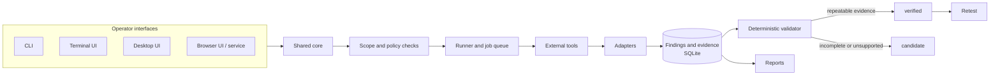

<div align="center">

# WHAXON

**A scope-controlled Python platform for authorized security assessments.**

Run security tools, normalize and correlate their findings, reproduce what can be verified, retest, and report with evidence attached.

[](https://github.com/andreipath26/WHAXON-AI-Forensics/actions/workflows/ci.yml)
[](https://pypi.org/project/whaxon/)
[](https://pypi.org/project/whaxon/)
[](LICENSE)
[](#-project-status)

**[Quick start](#-quick-start) · [How it works](#-how-it-works) · [Validation](#-finding-validation) · [Interfaces](#-interfaces) · [Safety](#-scope--safety) · [Roadmap](#-project-status) · [Documentation](#-documentation)**

</div>

---

> [!IMPORTANT]
> **Authorized use only.** Use WHAXON only on systems you own or are explicitly authorized to assess. It is not a hosted scanning service, does not guarantee complete vulnerability coverage, and does not replace written authorization or rules of engagement.

## 🧭 What is WHAXON?

WHAXON is an operator-controlled Python platform that brings the stages of a security assessment into one traceable workflow:

1. **Execute** supported external command-line tools through a shared catalog, runner and job lifecycle.
2. **Normalize** tool output into a common finding model while retaining source details and provenance.
3. **Correlate** related observations from different tools to support investigation.
4. **Validate** selected finding types with deterministic replay or read-only observation. Unsupported or inconclusive results remain candidates for human review.
5. **Retest** previously verified findings and distinguish fixed, still-vulnerable and inconclusive outcomes.
6. **Report** findings, evidence, verification state and coverage gaps.

WHAXON provides a CLI, terminal UI, desktop UI and browser UI on a shared core. Engagement and finding data are stored locally in SQLite by default.

An optional AI planning layer can suggest next steps. It cannot authorize actions, override policy or decide whether a finding is verified.

**What WHAXON is not:** it does not bundle the external scanners it drives. Nmap, Nikto, Nuclei, SQLmap and other tools are separate installations. A catalog entry does not mean a tool is installed, licensed, configured or supported on your operating system.

## ⚡ Quick start

**Requirements:** Python 3.11 or newer. A virtual environment is strongly recommended.

```bash
python3 -m venv .venv
source .venv/bin/activate
python -m pip install --upgrade pip
python -m pip install "whaxon[tui,web]"
```

Optional extras: `tui`, `web`, `gui`, `metasploit`, `dev`.

```bash
python -m pip install "whaxon[gui]"          # desktop interface
python -m pip install "whaxon[tui,web,gui]"  # combine interfaces
```

### First run

```bash
whaxon setup --profile core   # read-only plan; installs nothing
whaxon doctor                 # inspect Python packages and external tools
whaxon init                   # initialize local data
whaxon scope --show           # review the active scope
whaxon --help                 # show commands in your installed version
```

> [!NOTE]
> The default scope is restrictive and intended for local or private lab use. Public or third-party targets require explicit authorization and explicit scope configuration. Read [Scope and authorization](docs/scope.md) before your first assessment.

<details>
<summary><strong>📦 Install from source</strong></summary>

```bash
git clone https://github.com/andreipath26/WHAXON-AI-Forensics.git
cd WHAXON-AI-Forensics
python3 -m venv .venv
source .venv/bin/activate
python -m pip install --upgrade pip
python -m pip install -e ".[tui,web,dev]"
```

</details>

## 🏗️ How it works



Scope is checked before tool execution and again before validation and retest replays. If scope evaluation raises an error, the check fails closed. Application-level scope checks are an important guardrail, not a substitute for network-level egress restrictions.

## 🔬 Finding validation

Validation is deterministic: **no LLM assigns a finding verdict.** WHAXON distinguishes what a configured check reproduced from what remains uncertain.

| State | Meaning |
|---|---|
| `verified` | The implemented check obtained the repeatable evidence required for that specific check. A reproducible proof is attached where supported. |
| `candidate` | Evidence is incomplete, replay is unsupported or unsafe, or the result is inconclusive. Analyst review is required. |
| `refuted` | The replay ran and the expected evidence did not appear. This does not prove that the vulnerability is absent. |

### Implemented validation coverage

The implemented checks include:

- Non-destructive SQL error probes.
- XSS canary checks; the canary must parse as an active SVG event handler.
- Command-execution canaries that do not appear in the submitted payload.
- Read-only observations for open TCP ports, missing HTTP security headers, insecure cookie flags and invalid TLS certificates.

See [Findings](docs/findings.md) for the authoritative implementation list. Evidence must be repeatable across samples. Timing alone, or failure to reproduce, remains `candidate`.

**Replay safety:** replays reject unsupported HTTP methods, block redirects, strip authentication headers, stay on the same host as the target and use differential evidence (baseline versus injected request).

**Retesting:** a verified finding can be retested and reported as `fixed`, `still_vulnerable` or `inconclusive`. An inconclusive result is not remediation. Retest refuses findings that are not verified.

> [!WARNING]
> A `verified` result is not a guarantee of exploitability, business impact or complete coverage. A failed replay does not prove that a vulnerability is absent. Finding types without an implemented replay path need manual investigation.

The [experiment audit](docs/WHAXON_EXPERIMENT_AUDIT_2026-10-25.md) documents research counterexamples, corrections and limitations.

## 🖥️ Interfaces

| Interface | Command | Technology |
|---|---|---|
| Command line | `whaxon --help` | Python CLI |
| Terminal UI | `whaxon tui` | Textual (`tui` extra) |
| Desktop UI | `whaxon gui` | PySide6 (`gui` extra) |
| Browser UI | `whaxon web` | Flask + server-sent events (`web` extra) |
| Web service | `whaxon serve` | Same web application, service-oriented launch |

`whaxon web` redirects to the **Obsidian Kinetic** interface at `/ui-v2`. The earlier `/ui` interface remains available as a compatibility route. The repository documents 22 page routes and browser tests for major page workflows. Pages whose backends are not implemented are hidden or disabled rather than presented with simulated data.

> [!NOTE]
> The redesigned UI is implemented but **not yet formally accepted**. Outstanding acceptance work includes visual-regression baselines, a complete visible-control inventory, accessibility review, CLI/web parity evidence and a deployment decision for externally loaded assets. See the [UI interaction and acceptance audit](docs/NEW_UI_INTERACTION_AUDIT.md).

## 🧰 Commands at a glance

```bash
# Prepare and inspect
whaxon setup --profile core        # profiles: core, standard, full, custom
whaxon doctor [--json] [--verify]  # --verify runs version probes, never scans

# Assess
whaxon run --help
whaxon recon --help
whaxon findings --help

# Validate, retest, cover and report
whaxon validate --help
whaxon retest --help
whaxon coverage --help
whaxon report --help               # supported engagement output formats

# Bug-bounty programmes (policy-gated)
whaxon bounty --help

# Optional AI planning (requires provider configuration)
whaxon ai --help
```

Command availability depends on the installed release. `whaxon --help` is authoritative.

## 🧩 Capabilities

| Area | What it provides |
|---|---|
| **Tool catalog and adapters** | Adapters for tools including Nmap, Nikto, Nuclei, SQLmap, WhatWeb, Gobuster, ffuf, WPScan and Burp exports, plus HAR ingestion. Catalog entries without a dedicated adapter may run without producing enriched findings. |
| **Finding model and correlation** | Common finding structure, source details and grouping of related observations. |
| **Scope and auditability** | Explicit in-scope and out-of-scope rules, restrictive defaults, fail-closed handling of invalid configuration and an audit log for scope changes. |
| **PTES coverage** | Skipped steps recorded and grouped by methodology phase: Recon, Enumeration and Vulnerability. |
| **Evidence and reports** | Local evidence storage; supported Markdown, HTML, PDF, JSON and engagement outputs. |
| **Dependency readiness** | `whaxon doctor` diagnostics and `whaxon setup` capability planning with explicit approval gates. |
| **Bug-bounty intake** | Policy files, a CLI gate and review-only import of public YesWeHack programme pages or supplied text. |
| **AI planning** | Optional, opt-in suggestions subject to operator approval and deterministic execution controls. |

See [Tools](docs/tools.md), [Adapters](docs/adapters.md), [Findings](docs/findings.md) and [Dependency readiness](docs/dependency-readiness.md).

### 🧪 Dependency readiness and guided setup

`whaxon doctor` checks the Python runtime, required and optional packages, packaged resources and curated external-tool version probes. Presence alone is never reported as READY. Diagnostics are read-only.

`whaxon setup` previews a capability profile and produces a deterministic plan bound to the environment and exact proposed actions. Installation is opt-in and constrained:

- Python packages must be on the manifest allowlist, installed into the active virtual environment, use the fixed PyPI index and wheels only, with no shell or privilege elevation, bounded timeout and post-install import/version verification.
- External tools use a separate, narrower installation flow. Linux apt installation is limited to Debian, Ubuntu and Kali; tools without a curated verification contract remain detected or manual-only.
- Every operation is approved by plan ID, and the local audit log redacts secrets.
- Completed package changes are not generally rolled back. Recreate the virtual environment if it becomes inconsistent.

Installing a tool never authorizes a scan. See [Dependency readiness](docs/dependency-readiness.md).

### 🎯 Bug-bounty intake

- `whaxon bounty run` requires exactly one matching programme policy.
- Web import accepts public YesWeHack URLs over HTTPS, with host/path/port validation and non-public DNS answers rejected, or pasted text.
- Imports create **review drafts only**. Drafts default to zero request and concurrency allowance, respect robots.txt, have an empty tool allowlist and disable AI permissions.
- An import never authorizes testing.

### 🤖 AI planning

AI is optional and requires provider configuration. It can propose plans and next steps; deterministic policy and execution controls decide what may run. Do not enable unattended execution until policy, allowed phases, budgets and stop conditions have been tested in an isolated lab. See [AI behavior](docs/ai.md) and [Agent architecture](docs/agent-architecture.md).

## 🛡️ Scope and safety

> [!WARNING]
> Scope checks are an application-level guardrail, **not a network firewall**. DNS answers can change after preflight checks, and third-party scanners may follow redirects or make secondary requests. A successful preflight does not guarantee that every connection made by every external tool remains within the intended boundary.

For anything beyond a disposable local lab:

1. Obtain written authorization covering assets, techniques, time windows and request limits.
2. Review the active scope before every run.
3. Enforce outbound restrictions independently (isolated VM/container, firewall rules or a scope-aware egress proxy).
4. Review each tool's options, credentials and potential impact.
5. Preserve logs and evidence. Stop if the authorization boundary is unclear.

### Web service configuration

The web service binds to `127.0.0.1:5001` by default. Configuration is environment-variable based:

| Variable | Default | Purpose |
|---|---|---|
| `WHAXON_HOST` | `127.0.0.1` | Bind address |
| `WHAXON_PORT` | `5001` | Port |
| `WHAXON_DATA` | `data` | Local data directory |
| `WHAXON_AUTH_USER` | `whaxon` | Username |
| `WHAXON_AUTH_PASS` | `whaxon` | Password |
| `WHAXON_AUTH_PASS_HASH` | unset | Pre-hashed password; takes priority over `WHAXON_AUTH_PASS` |

> [!CAUTION]
> Default credentials are public. Change them before exposing the service, and place it behind a trusted reverse proxy with HTTPS. Defaults may change between versions; verify against [Deployment](docs/deployment.md).

```bash
whaxon serve --daemon
```

See [Deployment](docs/deployment.md) for systemd, Docker, reverse proxy and operational guidance, and [SECURITY.md](SECURITY.md) for the security policy.

## 📍 Project status

| Area | Current status |
|---|---|
| **Maturity** | Alpha. Interfaces and integrations are changing. |
| **Published release** | Latest PyPI release identified in the repository documentation: `0.11.16`. `main` may be ahead of the published package. A v1.0 release has **not** happened; the roadmap checklist remains open. |
| **Python support** | Python 3.11–3.13. PyPI classifies the package as Linux (POSIX); setup also detects macOS and Windows package managers. External-tool installation is supported only on selected hosts. |
| **Maintainers** | One maintainer. |
| **CI** | Ruff, mypy, pytest, boundary tests, package build and clean-wheel smoke checks, including `whaxon doctor --json`. Green CI is useful evidence, not proof of safety on every target or deployment. |
| **Engine v2** | Partially implemented: versioned mission/task contracts, persistence, scheduler/recovery primitives and an initial read-only scanner-provider slice. Not deployment-ready. |

Engine v2 still needs security acceptance, production recovery guarantees, broader provider migration, a shared CLI/API/headless lifecycle, supplied-UI integration and end-to-end release gates. See the [Engine v2 architecture and roadmap crosswalk](docs/ENGINE_V2_ARCHITECTURE_AND_ROADMAP_CROSSWALK.md), [project state](docs/STATE.md) and master roadmap §49.

### Roadmap and release discipline

The master roadmap is the source of truth for planned work and v1.0 acceptance. A feature described in the roadmap is not necessarily implemented or released. Likewise, a successful CI run does not by itself establish release readiness.

## 👩‍💻 Development

Install the `dev` extra and the required browser-test tooling, then run:

```bash
ruff check src tests
mypy src
python -m pytest tests/ -q
python -m build
python -m twine check dist/*
```

See [CONTRIBUTING.md](CONTRIBUTING.md) and the [Engineering Execution Model](docs/ENGINEERING_EXECUTION_MODEL.md). Contributions fall under the [CLA](CLA.md).

## 📚 Documentation

| Architecture and concepts | Engineering reference | Operations | Project |
|---|---|---|---|
| [Architecture](docs/architecture.md) | [Tools](docs/tools.md) | [Deployment](docs/deployment.md) | [Project state](docs/STATE.md) |
| [Scope and authorization](docs/scope.md) | [Adapters](docs/adapters.md) | [Dependency readiness](docs/dependency-readiness.md) | [Master roadmap](<WHAXON ROAD MAP - WHATS NEXT - FULL SCOPE.md>) |
| [Findings](docs/findings.md) | [HTTP API](docs/api.md) | [Troubleshooting](docs/troubleshooting.md) | [Changelog](docs/CHANGELOG.md) |
| [AI behavior](docs/ai.md) | [Reports and evidence](docs/reports-and-evidence.md) | [Security policy](SECURITY.md) | [Experiment audit](docs/WHAXON_EXPERIMENT_AUDIT_2026-10-25.md) |
| [Interfaces](docs/interfaces.md) | [Agent architecture](docs/agent-architecture.md) | [Licensing](docs/licensing.md) | [UI acceptance audit](docs/NEW_UI_INTERACTION_AUDIT.md) |

Additional references: [Documentation index](docs/README.md), [Documentation reconciliation](docs/DOCUMENTATION_RECONCILIATION.md), [Commercial licensing](docs/commercial-licensing.md), [Third-party notices](THIRD_PARTY_NOTICES.md) and [Trademark](TRADEMARK.md).

## 🌱 Related projects

[KILN](https://github.com/andreipath26/KILN) and [Aletheia Framework](https://github.com/andreipath26/aletheia-framework) are separate projects. Do not assume they are integrated with WHAXON.

## 🤝 Responsible use

You are responsible for obtaining permission, defining and respecting scope, complying with applicable law and programme rules, and reviewing the impact of each tool and action. Use WHAXON only on systems you own or are explicitly authorized to assess.

## 📄 License

WHAXON is licensed under [AGPL-3.0-or-later](LICENSE). Separate [commercial licensing](LICENSE-COMMERCIAL.md) and [enterprise terms](LICENSE-ENTERPRISE.md) are available. See the [licensing guide](docs/licensing.md), [THIRD_PARTY_NOTICES.md](THIRD_PARTY_NOTICES.md) and [TRADEMARK.md](TRADEMARK.md). Obtain independent legal advice for your intended use.

<div align="center">

**WHAXON — evidence first. Operator in control.**

</div>
