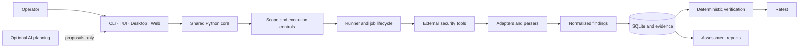

<div align="center">

# WHAXON

### Evidence-first security assessment. Operator-controlled execution. Reproducible results.

WHAXON connects security-tool execution, finding analysis, deterministic verification, retesting and evidence-backed reporting in one traceable workflow.

[](https://github.com/andreipath26/WHAXON-AI-Forensics/actions/workflows/ci.yml)
[](https://pypi.org/project/whaxon/)
[](https://pypi.org/project/whaxon/)
[](LICENSE)
[](#-product-maturity)

**[Quick start](#-quick-start) · [Workflow](#-the-whaxon-workflow) · [Verification](#-evidence--verification) · [Architecture](#-architecture) · [Interfaces](#-interfaces) · [Roadmap](#-product-maturity) · [Documentation](#-documentation)**

</div>

---

> [!IMPORTANT]
> **Authorized use only.** WHAXON is designed for systems you own or are explicitly authorized to assess. It is not a hosted scanning service, does not guarantee complete vulnerability coverage, and does not replace written authorization or rules of engagement.

## 🧭 The problem — and the WHAXON approach

A security assessment rarely happens in one tool. Operators move between scanners, scripts, consoles and report formats. The resulting evidence is fragmented: observations are duplicated, findings are difficult to reproduce, and a scanner's claim can be mistaken for a confirmed vulnerability.

WHAXON is built around a stricter distinction:

**An observation is not automatically a finding. A finding is not automatically verified. A verification result is not a remediation outcome.**

The platform brings those stages together while keeping authorization, consequential actions and final interpretation under operator control. Its purpose is not simply to run more tools; it is to make assessment activity easier to inspect, reproduce and explain.

## ⚡ The WHAXON workflow

<table>
<tr>
<td align="center" width="16%"><strong>01</strong><br/>🎯<br/><strong>Scope</strong><br/><sub>Define the boundary</sub></td>
<td align="center" width="16%"><strong>02</strong><br/>🧰<br/><strong>Execute</strong><br/><sub>Run selected tools</sub></td>
<td align="center" width="16%"><strong>03</strong><br/>🧩<br/><strong>Normalize</strong><br/><sub>Structure observations</sub></td>
<td align="center" width="16%"><strong>04</strong><br/>🔬<br/><strong>Verify</strong><br/><sub>Reproduce where supported</sub></td>
<td align="center" width="16%"><strong>05</strong><br/>🔁<br/><strong>Retest</strong><br/><sub>Check remediation</sub></td>
<td align="center" width="16%"><strong>06</strong><br/>📊<br/><strong>Report</strong><br/><sub>Preserve evidence</sub></td>
</tr>
</table>

1. **Establish scope.** Configure explicit in-scope and excluded assets. Invalid or missing scope configuration does not silently permit arbitrary targets.
2. **Assess readiness.** Inspect Python dependencies and external-tool availability; review a proposed installation plan before approving eligible changes.
3. **Execute.** Run supported tools through a shared runner and job lifecycle.
4. **Normalize and correlate.** Convert supported output into structured findings while retaining source details and provenance.
5. **Verify selectively.** Apply deterministic, finding-specific checks. Unsupported or inconclusive results remain candidates for analyst review.
6. **Retest and report.** Revisit eligible verified findings and produce job-level or engagement-level reports with documented limitations.

## 🔬 Evidence & verification

WHAXON does not treat a scanner's output as proof by default. The verification state describes what the implemented check actually established.

| State | Meaning |
|---|---|
| **verified** | The implemented check obtained the repeatable evidence required for that specific check. |
| **candidate** | Evidence is incomplete, the check is unsupported or unsafe, or the result is inconclusive. Analyst review is required. |
| **refuted** | A replay ran and the expected evidence did not appear. This does **not** prove that the vulnerability is absent. |

**Verification is deterministic.** An LLM does not assign a verification verdict. Timing differences alone remain inconclusive. Retesting is limited to eligible verified findings and records `fixed`, `still_vulnerable` or `inconclusive`.

> [!WARNING]
> A `verified` result is bounded by the check that produced it. It is not a guarantee of exploitability, business impact or complete coverage. Unsupported, skipped and inconclusive work must never be represented as tested or verified.

### What the evidence model preserves

- The source tool and original output line, alongside normalized finding data.
- Target and request context where available, including the context needed by supported deterministic checks.
- Finding severity, remediation guidance and references where supplied by the adapter.
- Persisted findings, job history and evidence references used by reports.
- The distinction between implemented code, observed test results and release acceptance.

See [Findings](docs/findings.md) and [Reports & evidence](docs/reports-and-evidence.md) for the implementation details and format-specific limits.

## 🧩 Capabilities

| Capability | What is present in the repository |
|---|---|
| **Tool orchestration** | Shared catalog, runner, job lifecycle and adapters for supported external tools. Tools are installed and licensed separately. |
| **Finding normalization** | Common finding records with source, structured data, raw output and request context where available. |
| **Correlation** | Groups related observations to support investigation while retaining their source records. |
| **Scope controls** | Explicit inclusion/exclusion rules, restrictive defaults and fail-closed handling of invalid configuration. |
| **Deterministic validation** | Selected SQL-error, reflected-XSS and command-injection checks, plus supported read-only observations. Coverage is finding- and request-specific. |
| **Retesting** | Retest path for eligible verified findings, with explicit fixed / still-vulnerable / inconclusive outcomes. |
| **Evidence & reporting** | Local evidence persistence and supported Markdown, HTML, PDF and JSON reporting paths. |
| **Dependency readiness** | Read-only diagnostics, capability-profile planning and approval-gated installation for a limited allowlist. |
| **Bug-bounty intake** | Review-only import of supported public YesWeHack programme information or supplied text. Import does not authorize testing. |
| **AI-assisted planning** | Optional proposals and recommendations. AI does not grant authorization, approve its own actions or assign verification verdicts. |

<details>
<summary><strong>🧪 Dependency readiness — what the setup flow does and does not do</strong></summary>

`whaxon doctor` inspects the runtime, Python packages, packaged resources and curated external-tool probes. Diagnostics are read-only.

`whaxon setup` previews a capability profile and creates a plan bound to the environment and proposed operations. Installation is a separate, opt-in step with explicit approval and a limited allowlist.

- Python package operations are constrained to approved packages and the active virtual environment.
- External-tool installation follows a separate, narrower platform-specific flow.
- Post-install checks verify the eligible operation; tool installation never authorizes a scan.
- Completed package changes are not generally rolled back. Recreate the virtual environment if it becomes inconsistent.

See [Dependency readiness](docs/dependency-readiness.md).

</details>

<details>
<summary><strong>🎯 Bug-bounty intake — review is not permission</strong></summary>

Supported public YesWeHack programme information or supplied text can be imported as a review draft. An import does not authorize testing, activate a programme or grant tools permission to run. Programme policy and explicit operator decisions remain separate gates.

See [Bug-bounty intake](docs/bounty-addon.md).

</details>

## 🏗️ Architecture

WHAXON combines a shared Python core with CLI, terminal, desktop and browser interfaces. The core coordinates scope checks, tool execution, adapters, persistence, validation and reporting. Local assessment data is stored in SQLite by default.



### Engine v2 — the next execution foundation

Engine v2 is the migration toward capability-driven, durable mission and task-graph execution. The current implementation includes versioned task/plan contracts, persistence, scheduler and recovery foundations, a shared Core integration, and an initial read-only scanner-provider slice.

This is **incremental infrastructure, not a completed autonomous mission engine**. Remaining acceptance includes the broader security and Trust Layer evidence gates, production recovery guarantees, capability/provider reconciliation, shared CLI/API/headless lifecycle and integrated end-to-end release checks. Unknown outcomes must not be treated as successful or automatically replayed.

The [Engine v2 architecture and roadmap crosswalk](docs/ENGINE_V2_ARCHITECTURE_AND_ROADMAP_CROSSWALK.md) records the implemented foundations, target architecture and remaining acceptance work.

## 🖥️ Interfaces

| Interface | Entry point | Notes |
|---|---|---|
| Command line | `whaxon --help` | Primary operator interface; installed-version help is authoritative. |
| Terminal UI | `whaxon tui` | Optional `tui` extra. |
| Desktop UI | `whaxon gui` | Optional `gui` extra. |
| Browser UI | `whaxon web` | Flask development entry point; defaults to the new `/ui-v2` interface. |
| Web service | `whaxon serve` | Service-oriented WSGI entry point; see deployment guidance. |

### The Obsidian Kinetic browser interface

The new browser implementation contains **22 production page routes/templates** and a Playwright suite with **21 UI-v2 test modules**. It uses the supplied Obsidian Kinetic visual system; the previous web interface is retained as a legacy/reference surface.

The implementation is substantial, but the UI is **not yet formally accepted**. Outstanding gates include:

- Visual-regression comparisons against the supplied design references.
- A complete inventory of visible controls and their real/disabled/hidden status.
- Full keyboard, focus-management and accessibility review.
- Explicit CLI/web service-parity evidence.
- A deployment decision and tests for externally loaded Tailwind/font assets.
- Browser and end-to-end acceptance on the exact release candidate.

Unsupported actions must remain hidden or disabled; reference-only controls and sample data are not delivered functionality. See the [New UI interaction and acceptance audit](docs/NEW_UI_INTERACTION_AUDIT.md).

## 🚀 Quick start

**Requirements:** Python 3.11 or newer. A virtual environment is recommended.

```bash
python3 -m venv .venv
source .venv/bin/activate
python -m pip install --upgrade pip
python -m pip install "whaxon[web]"
```

### First run

```bash
whaxon setup --profile core   # Read-only plan; installs nothing
whaxon doctor                 # Inspect Python packages and external tools
whaxon init                   # Initialize local data
whaxon scope --show           # Review the active scope
whaxon --help                 # Show commands in the installed version
```

The default scope is restrictive and intended for loopback/private lab use. Review [Scope and authorization](docs/scope.md) before your first assessment.

<details>
<summary><strong>📦 Install from source</strong></summary>

```bash
git clone https://github.com/andreipath26/WHAXON-AI-Forensics.git
cd WHAXON-AI-Forensics
python3 -m venv .venv
source .venv/bin/activate
python -m pip install --upgrade pip
python -m pip install -e ".[web,dev]"
```

</details>

<details>
<summary><strong>⌨️ Useful command groups</strong></summary>

```bash
whaxon run --help
whaxon recon --help
whaxon findings --help
whaxon validate --help
whaxon retest --help
whaxon coverage --help
whaxon report --help
whaxon bounty --help
whaxon ai --help
```

Command availability depends on the installed release. `whaxon --help` is authoritative.

</details>

### Deployment

Use `whaxon serve` for the service-oriented WSGI entry point. `whaxon web` starts the Flask development server and should remain local.

The default web credentials are public demonstration defaults and are not suitable for network-facing deployment. Configure unique credentials, bind appropriately, and use a trusted HTTPS reverse proxy. Review [Deployment](docs/deployment.md) and [SECURITY.md](SECURITY.md) before exposing the service.

## 🛡️ Scope, safety & operational boundaries

> [!WARNING]
> Scope checks are application-level controls, **not a network firewall**. DNS answers can change after preflight checks, and third-party scanners may follow redirects or make secondary requests. A successful scope check does not guarantee that every connection made by every external tool remains within the intended boundary.

For anything beyond a disposable local lab:

1. Obtain written authorization covering assets, techniques, time windows and request limits.
2. Review the active scope before every run.
3. Enforce outbound restrictions independently through an isolated VM/container, firewall or scope-aware egress proxy.
4. Review each tool's options, credentials and potential impact.
5. Preserve logs and evidence; stop if the authorization boundary is unclear.

Other boundaries worth understanding:

- External scanners are separate dependencies; WHAXON does not bundle every tool in its catalog.
- A catalog entry does not prove that a tool is installed, licensed, compatible or fully validated end to end.
- Verification covers selected finding types and request shapes, not every vulnerability class.
- AI output is a proposal, not authorization, execution evidence or a verification verdict.
- Dependency installation is allowlisted and approval-gated, but completed package changes are not generally rolled back.

See [Scope](docs/scope.md), [Security policy](SECURITY.md) and [Data retention](docs/DATA_RETENTION.md).

## 📍 Product maturity

WHAXON is currently a **Beta** software project. The repository is actively developed; implementation, verification and release acceptance are tracked as separate states.

| Item | Observed position |
|---|---|
| **Published package** | `0.11.16` on PyPI. The current `main` branch contains development beyond that published package; do not assume every main-branch capability is in the wheel. |
| **Package maturity** | Beta (`Development Status :: 4 - Beta` in package metadata). |
| **v1.0.0 release** | Not released. The master roadmap's §38 acceptance checklist remains open. |
| **Engine v2** | Contracts, persistence, scheduler/recovery foundations and an initial read-only provider slice are implemented; broader security and operational acceptance remains open. |
| **Browser UI** | 22 production routes/templates; formal visual, accessibility, control-inventory, parity and deployment-asset gates remain open. |
| **CI** | The badge above reflects the live workflow. Check the Actions run for the exact commit being evaluated; a passing run on an earlier commit is not evidence for current HEAD. |

**Release discipline:** a roadmap item, a merged implementation, a passing unit test and a published release are different kinds of evidence. WHAXON should not be represented as a completed v1.0 release or a production-ready autonomous assessment platform until the controlling release gates are closed.

The master roadmap is the project source of truth: [WHAXON roadmap](<WHAXON ROAD MAP - WHATS NEXT - FULL SCOPE.md>). Its §0 defines execution order and parallel-work rules; §38 controls v1.0 acceptance.

## 📚 Documentation

| Architecture & concepts | Engineering & product | Operations & governance |
|---|---|---|
| [Architecture](docs/architecture.md) | [Tools](docs/tools.md) · [Adapters](docs/adapters.md) | [Getting started](docs/getting-started.md) |
| [Scope & authorization](docs/scope.md) | [Findings](docs/findings.md) · [Reports & evidence](docs/reports-and-evidence.md) | [Deployment](docs/deployment.md) |
| [AI behavior](docs/ai.md) · [Agent architecture](docs/agent-architecture.md) | [Engine v2 crosswalk](docs/ENGINE_V2_ARCHITECTURE_AND_ROADMAP_CROSSWALK.md) | [Dependency readiness](docs/dependency-readiness.md) |
| [HTTP API](docs/api.md) · [Interfaces](docs/interfaces.md) | [UI acceptance audit](docs/NEW_UI_INTERACTION_AUDIT.md) | [Security policy](SECURITY.md) |
| [Business impact](docs/business-impact.md) · [Bounty intake](docs/bounty-addon.md) | [Changelog](docs/CHANGELOG.md) · [Documentation index](docs/README.md) | [Licensing](docs/licensing.md) · [Commercial licensing](docs/commercial-licensing.md) |
| [Master roadmap](<WHAXON ROAD MAP - WHATS NEXT - FULL SCOPE.md>) | [v1.0 acceptance register](docs/V1_0_BASELINE_AND_ACCEPTANCE_REGISTER.md) | [Third-party notices](THIRD_PARTY_NOTICES.md) · [Trademark](TRADEMARK.md) |

## 📄 Licensing

The community code is licensed under **[AGPL-3.0-or-later](LICENSE)**. A separate commercial licence may be discussed for use cases that cannot comply with the AGPL, but this repository notice is not itself a licence grant: additional rights exist only under a separately signed written agreement.

There is currently no separately published enterprise edition or standard enterprise agreement. Review [commercial licensing](docs/commercial-licensing.md), [third-party notices](THIRD_PARTY_NOTICES.md) and [trademark guidance](TRADEMARK.md); obtain independent legal advice for a specific use or distribution.

---

<div align="center">

### WHAXON

**Evidence first. Operator in control.**

<sub>Know what ran. Know what was observed. Know what was verified.</sub>

</div>
